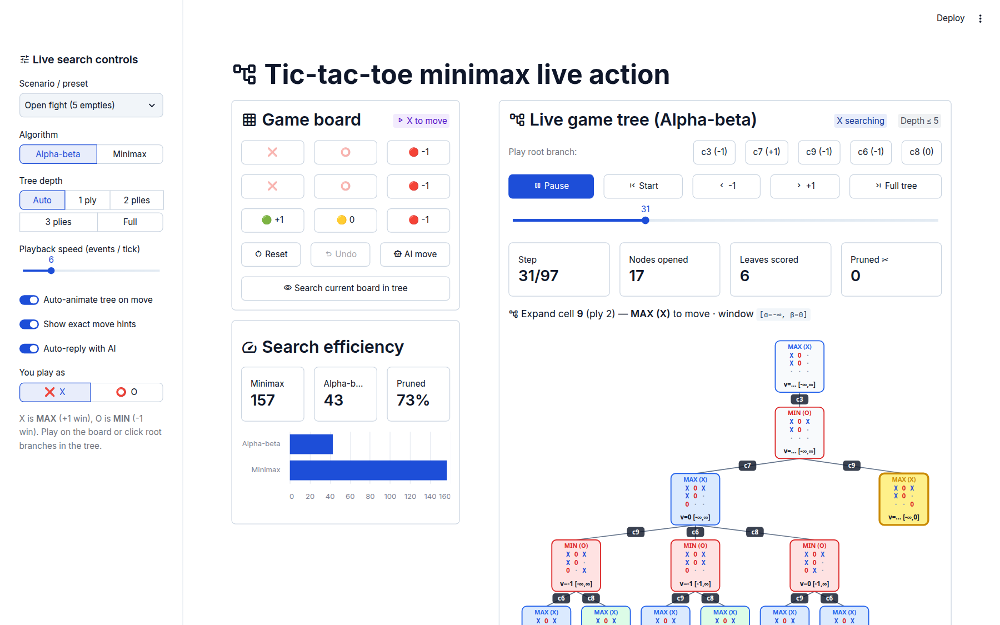

# Tic-Tac-Toe Minimax Live Action

Interactive Streamlit visualizer for **Minimax** and **Alpha-Beta Pruning** on Tic-Tac-Toe. Play on the board or click root branches directly in the search tree while watching the AI's game tree expand, backtrack, and prune branches in real time.



## Features

- **Live game tree action**: Auto-animates node expansion, utility backtracking, `[α, β]` windows, and alpha-beta cutoffs (`✂`) on every move.
- **Interactive root branches**: Trigger moves directly from the game tree or the 3×3 board with optional exact move-value hints (`+1` win, `0` draw, `-1` loss).
- **Search efficiency comparison**: Real-time node counts and pruning percentage comparing plain Minimax against Alpha-Beta pruning.
- **Configurable playback**: Adjust search depth (`Auto`, `1–3 plies`, `Full`), playback speed, presets, and step-by-step scrubbing.

## Run

```bash
uv run streamlit run app.py
```
